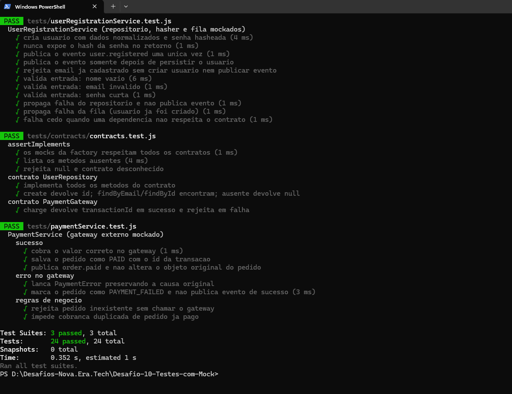
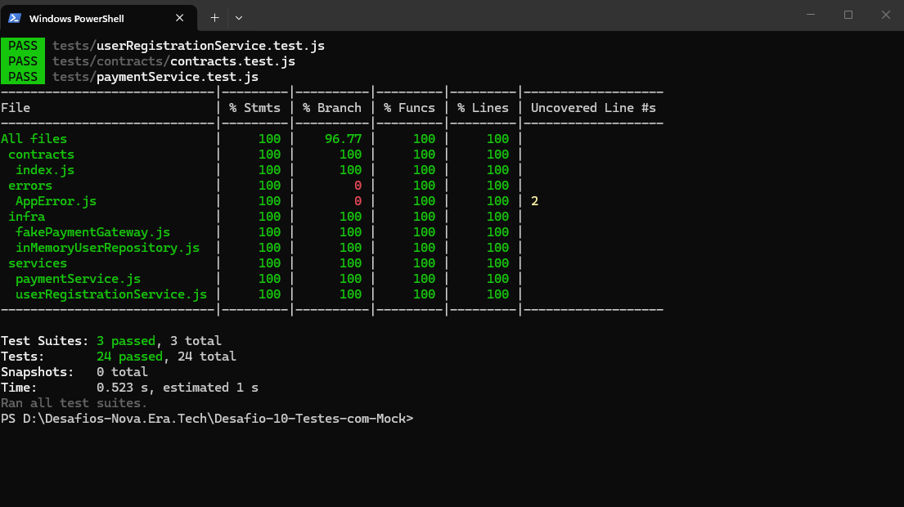

# Desafio 10 — Testes com Mock

Testes unitários com Jest para services que dependem de banco, gateway de pagamento externo e fila, **sem nenhuma infraestrutura real**.

## Como rodar

```bash
npm install
npm test
npm run test:coverage
```

## Evidências

**Testes (24 aprovados em 3 suítes)**



**Cobertura**



## Estrutura

```
src/
  contracts/   contratos das dependências + assertImplements()
  services/    UserRegistrationService, PaymentService
  infra/       fakes que respeitam os contratos (memória / sem rede)
  errors/      erros de negócio
tests/
  factories/   factory de dados fake + buildMocks()
  contracts/   testes de contrato
  *.test.js    testes dos services
```

## O que é testado

- **Cadastro de usuário** (repositório, hasher e fila mockados): normalização de dados, hash da senha, conflito de e-mail, validações, evento `user.registered` publicado só após persistir (`invocationCallOrder`), propagação de falhas.
- **Pagamento** (gateway externo mockado): sucesso (`mockResolvedValue`) e erro (`mockRejectedValue`), pedido salvo como `PAID`/`PAYMENT_FAILED`, `PaymentError` preservando a causa, pedido inexistente, cobrança duplicada.
- Validação de chamadas com `toHaveBeenCalledWith`, `toHaveBeenCalledTimes` e `not.toHaveBeenCalled`.

## Decisões

- Services recebem dependências por **injeção no construtor**; `assertImplements` valida o contrato e falha cedo se faltar método.
- Os mocks vêm de `buildMocks()`, recriados a cada teste (`beforeEach`) — sem estado compartilhado, testes rápidos e determinísticos.
- **Opcionais:** factory de dados fake (`tests/factories/fakeData.js`) e testes de contrato (os fakes de `src/infra` devem se comportar como os mocks assumem).
