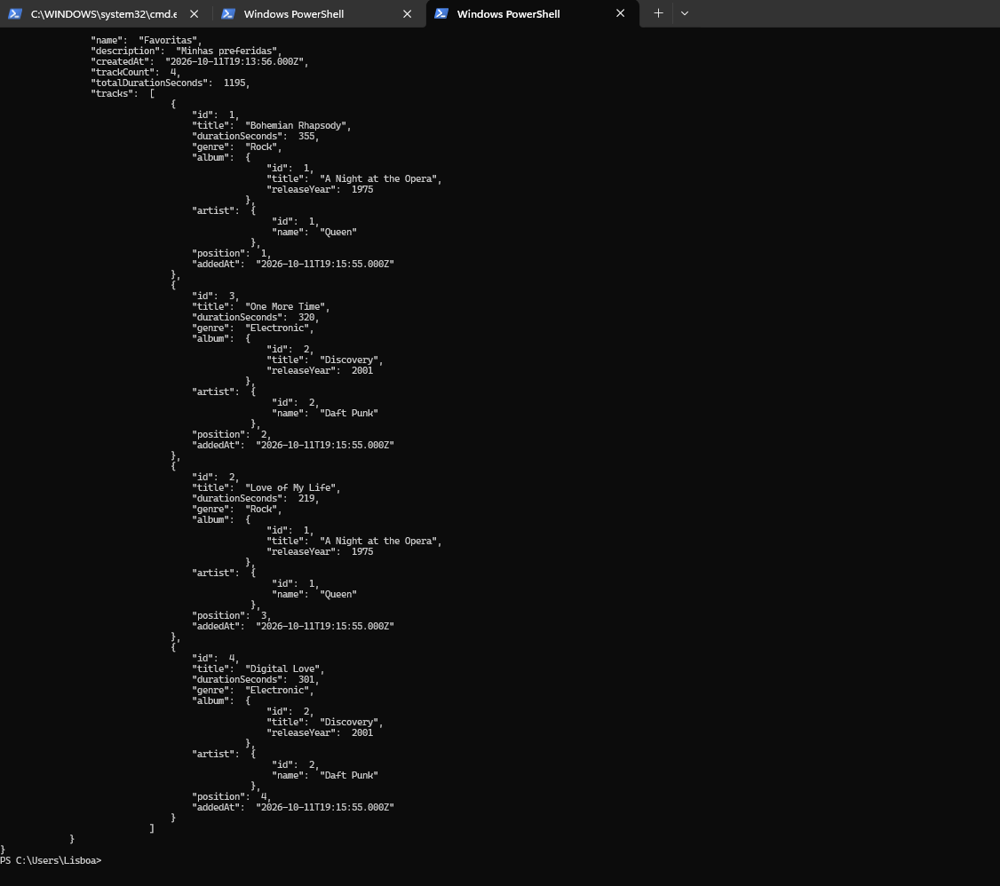

# Desafio 11 — API estilo Spotify

API REST em **NestJS + TypeORM** (SQLite via `sql.js`, sem dependências nativas) com artistas, álbuns, faixas e playlists.

## Rodando

```bash
npm install
npm run start:dev   # http://localhost:3000 (banco em data/spotify.db)
npm test            # testes e2e com banco em memória
```

## Modelo

```
Artist 1──N Album 1──N Track N──N Playlist   (via playlist_tracks: position, addedAt, UNIQUE(playlist, track))
```

- Faixa pertence a um álbum; o artista vem do álbum.
- Remover **artista com álbuns** ou **álbum com faixas** → `409`.
- Remover **faixa** ou **playlist** limpa os vínculos (`ON DELETE CASCADE`).

## Endpoints

| Recurso | Rotas |
|---|---|
| Artistas | `POST/GET /artists`, `GET/PATCH/DELETE /artists/:id` (`?q=`) |
| Álbuns | `POST/GET /albums`, `GET/PATCH/DELETE /albums/:id` (`?q=&artistId=`) |
| Faixas | `POST/GET /tracks`, `GET/PATCH/DELETE /tracks/:id` (`?q=&genre=&albumId=&artistId=`) |
| Playlists | `POST/GET /playlists`, `GET/PATCH/DELETE /playlists/:id` |
| Playlist ↔ faixa | `POST /playlists/:id/tracks` `{ "trackId": 1 }`, `DELETE /playlists/:id/tracks/:trackId` |
| Busca | `GET /search?q=` — por nome da faixa **ou** do artista |
| Opcional | `GET /tracks/ranking?limit=` (mais adicionadas), `GET /recommendations?genre=` |

Todas as listagens aceitam `?page=1&limit=10` (máx. 100).

## Payloads

- Item: `{ "data": { ... } }`
- Lista: `{ "data": [...], "meta": { "page", "limit", "total", "totalPages" } }`
- Playlist (lista e detalhe) traz `trackCount` e `totalDurationSeconds`; o detalhe inclui `tracks` ordenadas por `position`.
- Erros: `{ "statusCode", "message", "error" }` — `400` validação, `404` não encontrado, `409` conflito (nome de artista repetido, faixa duplicada na playlist, remoção com dependentes).

## Evidências

**`GET /playlists/1` — playlist com 4 faixas, duração total (1195 s) e artista/álbum aninhados**



## Exemplo

```bash
curl -X POST localhost:3000/artists -H "Content-Type: application/json" -d '{"name":"Queen"}'
curl -X POST localhost:3000/albums  -H "Content-Type: application/json" -d '{"title":"A Night at the Opera","artistId":1}'
curl -X POST localhost:3000/tracks  -H "Content-Type: application/json" -d '{"title":"39","durationSeconds":210,"genre":"Rock","albumId":1}'
curl -X POST localhost:3000/playlists -H "Content-Type: application/json" -d '{"name":"Favoritas"}'
curl -X POST localhost:3000/playlists/1/tracks -H "Content-Type: application/json" -d '{"trackId":1}'
curl localhost:3000/playlists/1
```
