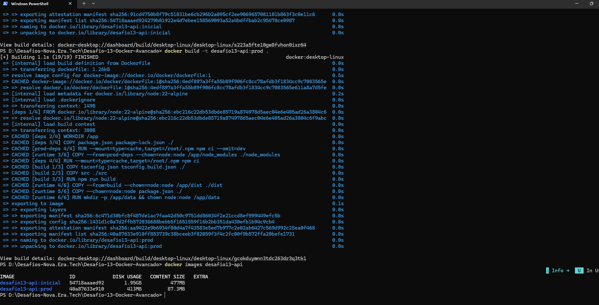
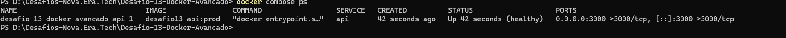
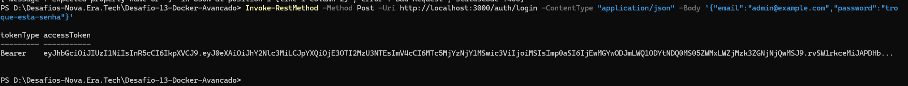
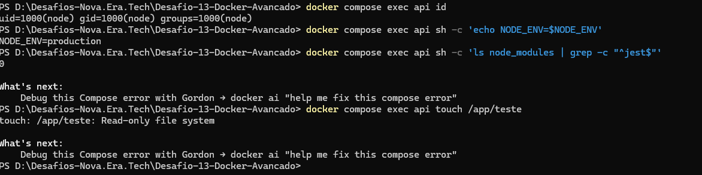
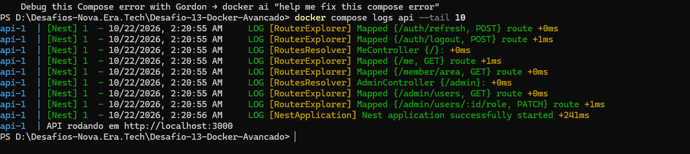

# Desafio 13 - Docker avancado

API de autenticacao do Desafio 12 (NestJS + TypeORM + JWT) empacotada com Docker em nivel proximo de producao: multi-stage build, imagem enxuta, usuario sem privilegios, cache de camadas e separacao dev/prod.

## Resultado

| Imagem | Dockerfile | Tamanho em disco | Conteudo comprimido |
|---|---|---|---|
| `desafio13-api:inicial` | `Dockerfile.inicial` (single-stage, `node:22`) | 1,95 GB | 477 MB |
| `desafio13-api:prod` | `Dockerfile` (multi-stage, `node:22-alpine`) | 413 MB | 87,3 MB |

Reducao de aproximadamente 79% no tamanho em disco.

## Estrategia do Dockerfile

| Estagio | Funcao |
|---|---|
| `deps` | `npm ci` com todas as dependencias, usando cache do npm (BuildKit) |
| `build` | compila o TypeScript para `dist/` |
| `prod-deps` | `npm ci --omit=dev`, apenas dependencias de producao |
| `runtime` | imagem final: copia somente `node_modules` de producao e `dist/` |

- Os arquivos `package*.json` sao copiados antes do codigo, entao o `npm ci` fica em cache enquanto as dependencias nao mudam.
- A imagem final nao contem Jest, supertest, tipos nem codigo-fonte TypeScript. O pacote `typescript` ainda aparece porque e dependencia transitiva do `typeorm` (via `ts-node`).
- `NODE_ENV=production` fixado na imagem; nesse modo a API exige `JWT_SECRET`.
- Roda como usuario `node` (uid 1000), nunca como root.
- `HEALTHCHECK` embutido (consulta `/me`; resposta 401 indica servidor vivo).
- `.dockerignore` evita enviar `node_modules`, `data`, testes e arquivos sensiveis ao contexto de build.

## Logs

A aplicacao escreve em stdout/stderr (padrao 12-factor), e o Docker coleta. No compose, o driver `json-file` tem rotacao (`max-size: 10m`, `max-file: 3`) para o disco nao crescer sem limite.

```bash
docker compose logs -f api
```

## Seguranca

- usuario nao-root
- `read_only: true` com `tmpfs` em `/tmp` (somente o volume `/app/data` e gravavel)
- `cap_drop: [ALL]` e `no-new-privileges`
- segredos via `.env` (fora do git e fora da imagem)

## Comandos

Configure as variaveis:

```bash
cp .env.example .env
```

Build da imagem de producao:

```bash
docker build -t desafio13-api:prod .
```

Run manual:

```bash
docker run -d --name api -p 3000:3000 --env-file .env -v api_data:/app/data desafio13-api:prod
```

Producao com compose:

```bash
docker compose up -d --build
```

Desenvolvimento (hot reload via bind mount de `src`, imagem com devDependencies):

```bash
docker compose -f docker-compose.dev.yml up --build
```

Comparar com a versao inicial:

```bash
docker build -f Dockerfile.inicial -t desafio13-api:inicial .
docker images desafio13-api
```

Verificacoes:

```bash
docker compose ps
docker compose exec api id
curl -i http://localhost:3000/me
```

## Opcional: scan de vulnerabilidades

```bash
docker run --rm -v /var/run/docker.sock:/var/run/docker.sock aquasec/trivy image desafio13-api:prod
```

ou, com Docker Scout:

```bash
docker scout cves desafio13-api:prod
```

## Validacao realizada

- container `healthy`, executando como `uid=1000(node)`, `NODE_ENV=production`
- `GET /me` sem token retorna 401; login do admin retorna os tokens
- Jest nao existe em `node_modules` da imagem final

## Evidencias (`prints/`)

1. `01-tamanho-imagens.png`: comparacao entre a imagem inicial (1,95 GB) e a otimizada (413 MB), com o segundo build inteiro em cache.
2. `02-container-healthy.png`: `docker compose ps` com o container `healthy`.
3. `03-api-funcionando.png`: login do admin retornando o token Bearer.
4. `04-seguranca.png`: usuario `uid=1000(node)`, `NODE_ENV=production`, Jest ausente da imagem e sistema de arquivos somente leitura.
5. `05-logs.png`: logs da aplicacao via `docker compose logs`.






