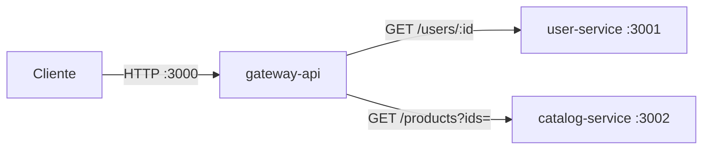
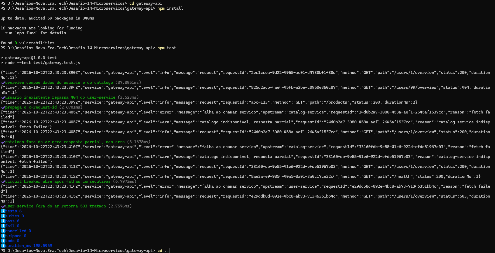
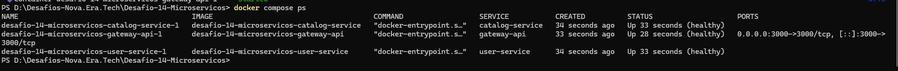
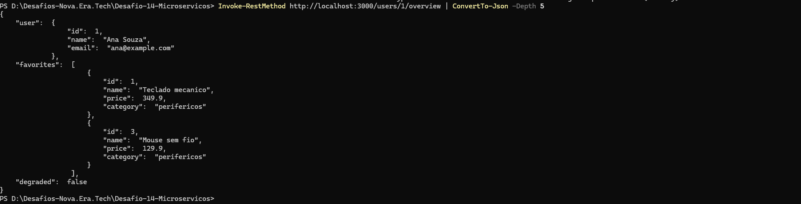
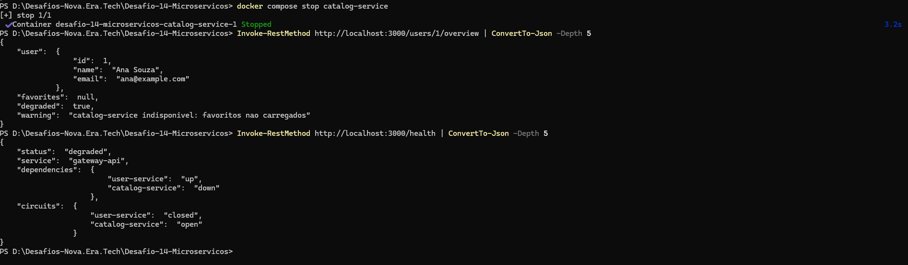
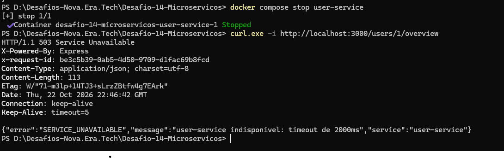
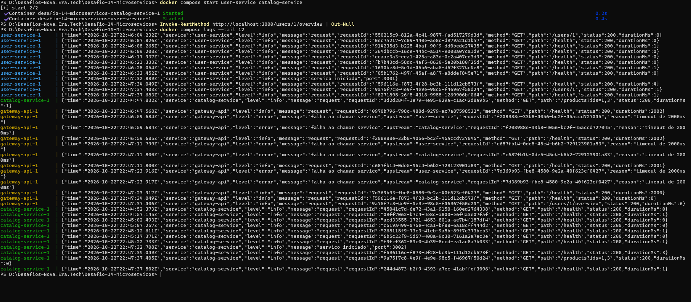

# Desafio 14 - Arquitetura com multiplos servicos

Sistema dividido em tres servicos independentes que se comunicam por HTTP: `user-service`, `catalog-service` e `gateway-api`. Orquestracao com Docker Compose.

## Arquitetura



Somente o gateway expoe porta para fora. Os outros dois servicos ficam na rede interna `backend` do Compose.

| Servico | Dominio | Dados | Porta interna |
|---|---|---|---|
| `user-service` | usuarios e seus produtos favoritos (ids) | proprio (em memoria) | 3001 |
| `catalog-service` | produtos | proprio (em memoria) | 3002 |
| `gateway-api` | composicao das respostas | nenhum | 3000 |

Cada servico tem seu proprio `package.json`, `Dockerfile` e repositorio de dados. O `user-service` guarda apenas os ids dos produtos favoritos e nunca acessa os dados do catalogo diretamente; quem junta as duas informacoes e o gateway.

## Endpoints do gateway

| Metodo | Rota | Descricao |
|---|---|---|
| GET | `/users/:id/overview` | usuario + produtos favoritos (endpoint agregado) |
| GET | `/products` | lista do catalogo (repasse) |
| GET | `/health` | estado do gateway, das dependencias e dos circuitos |

Cada servico tambem expoe `/health`. O `user-service` tem `/users` e `/users/:id`; o `catalog-service` tem `/products`, `/products/:id` e `/products?ids=1,3`.

## Tratamento de falhas

- Timeout por chamada (`REQUEST_TIMEOUT_MS`, padrao 2000 ms) com `AbortController`.
- Falha do `catalog-service`: o overview responde 200 com `degraded: true`, `favorites: null` e um aviso. O usuario continua sendo retornado.
- Falha do `user-service`: o gateway responde 503 com `SERVICE_UNAVAILABLE` e o nome do servico, sem derrubar o processo.
- Erros 4xx dos servicos (por exemplo usuario inexistente) sao repassados com o mesmo status.
- Circuit breaker simples por servico (opcional do desafio): apos `BREAKER_FAILURE_THRESHOLD` falhas seguidas o circuito abre e as chamadas falham na hora; apos `BREAKER_RESET_MS` ele tenta novamente (half-open).

## Observabilidade

- Logs em JSON, uma linha por evento, sempre com o campo `service`.
- O gateway gera um `x-request-id` (ou reaproveita o recebido) e o repassa aos servicos, entao e possivel seguir uma requisicao pelos tres logs.
- `/health` do gateway mostra o estado de cada dependencia e do circuito.

## Configuracao por variavel de ambiente

| Servico | Variavel | Padrao |
|---|---|---|
| todos | `SERVICE_NAME`, `PORT` | nome do servico / 3001, 3002, 3000 |
| gateway-api | `USER_SERVICE_URL` | `http://user-service:3001` (compose) |
| gateway-api | `CATALOG_SERVICE_URL` | `http://catalog-service:3002` (compose) |
| gateway-api | `REQUEST_TIMEOUT_MS` | 2000 |
| gateway-api | `BREAKER_FAILURE_THRESHOLD` | 3 |
| gateway-api | `BREAKER_RESET_MS` | 10000 |

## Como executar

```bash
cp .env.example .env
docker compose up -d --build
docker compose ps
```

Consulta agregada:

```bash
curl http://localhost:3000/users/1/overview
```

Acompanhar logs de todos os servicos:

```bash
docker compose logs -f
```

## Demonstracao de falha

Derrubar o catalogo e consultar de novo (resposta parcial):

```bash
docker compose stop catalog-service
curl http://localhost:3000/users/1/overview
curl http://localhost:3000/health
```

Derrubar tambem o usuario (503 tratado):

```bash
docker compose stop user-service
curl -i http://localhost:3000/users/1/overview
```

Recuperar:

```bash
docker compose start user-service catalog-service
```

## Testes

Os testes do gateway sobem servicos falsos e validam composicao, repasse de 404, `x-request-id`, resposta parcial, circuit breaker e 503.

```bash
cd gateway-api
npm install
npm test
```

## Evidencias (`prints/`)

1. `01-testes.png`: 6 testes do gateway passando.
2. `02-servicos-healthy.png`: os tres servicos `healthy`; apenas o gateway expoe porta.
3. `03-overview-agregado.png`: endpoint agregado compondo usuario (user-service) e favoritos (catalog-service).
4. `04-falha-catalogo.png`: catalogo parado, resposta parcial (`degraded: true`), `/health` com `catalog-service: down` e circuito aberto.
5. `05-falha-usuario.png`: user-service parado, gateway responde 503 tratado por timeout.
6. `06-logs.png`: logs JSON com o nome do servico; o mesmo `requestId` aparece no gateway, no user-service e no catalog-service.







